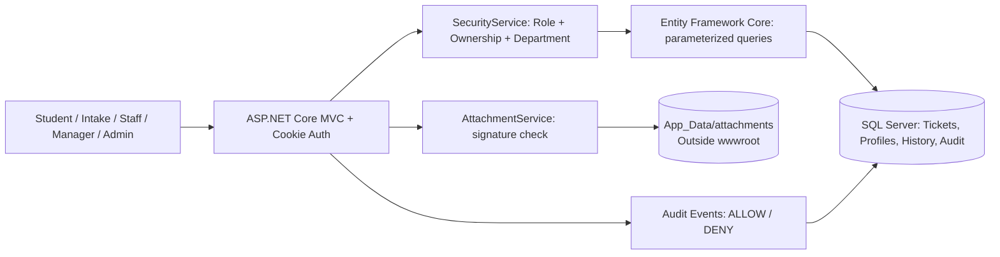
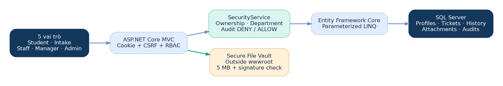
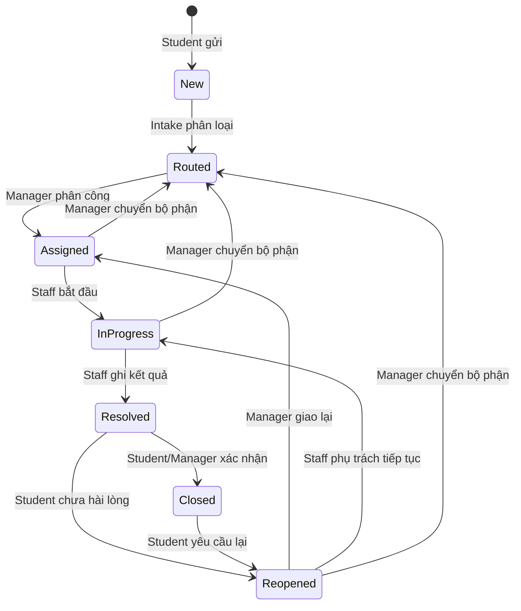
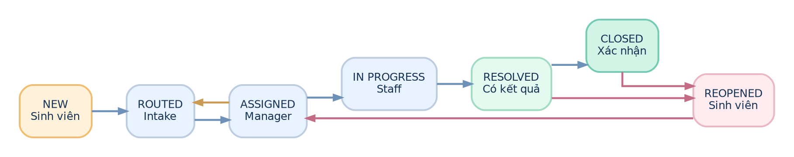

# M12 – HỖ TRỢ NGƯỜI HỌC
## Kế hoạch thực hiện, hướng dẫn cài đặt, kiểm thử bảo mật và kịch bản bảo vệ giữa kỳ

**Môn học:** Bảo mật cơ sở dữ liệu  
**Module:** M12 – Hỗ trợ người học / Student Support Security Lab  
**Nền tảng:** ASP.NET Core MVC (.NET 10), EF Core, SQL Server, SSMS  
**Phiên bản bàn giao:** M12 v2 – Secure Workflow Showcase  
**Lưu ý:** Hệ thống sử dụng dữ liệu giả lập; bản này chưa được biên dịch, chạy thực tế trên máy Windows/SQL Server tại môi trường tạo gói. Cần tự kiểm thử và cập nhật kết quả minh chứng trước khi nộp. Không có cam kết trước về điểm số.

---

## 1. Bối cảnh và mục tiêu

M12 thuộc **Nhóm 3 – Hỗ trợ học viên và sinh viên**, có mục tiêu theo dõi yêu cầu hỗ trợ xuyên suốt **tiếp nhận → phân loại → phân công → xử lý/phối hợp → phản hồi → đóng hoặc mở lại**. Dữ liệu nghiệp vụ phải lưu người yêu cầu, mã hồ sơ người học chuẩn, loại yêu cầu, mô tả, đơn vị, ưu tiên, trạng thái, lịch sử, tệp và phản hồi.

Đây là bài cho **môn Bảo mật cơ sở dữ liệu**, do đó sản phẩm phải có **hai lớp kết quả**: (A) nghiệp vụ chạy thông suốt và (B) cơ chế bảo vệ dữ liệu có thể kiểm chứng bằng tình huống thực nghiệm. Không đánh đồng “ẩn nút” với phân quyền; không đánh đồng kiểm tra ownership tại ASP.NET với SQL Server Row-Level Security.

**Các điểm khác với bản M12 v1:** bản cũ tạo ticket `DepartmentId=NULL` nhưng Manager chỉ nhìn thấy ticket đã có `DepartmentId`, làm tắc phân công. V2 đưa vào vai trò trung tâm `Intake`, thêm chuyển bộ phận, tệp lưu an toàn, history chi tiết, bảng dashboard audit.

## 2. Yêu cầu và tiêu chí nghiệm thu

| ID | Yêu cầu nghiệp vụ | Cách chứng minh |
|---|---|---|
| BR01 | Sinh viên tạo ticket theo mã sinh viên chuẩn | Tạo ticket, kiểm tra StudentCode FK bằng SSMS |
| BR02 | Trung tâm tiếp nhận nhìn thấy ticket New | Đăng nhập `intake`, Queue hiển thị ngay |
| BR03 | Tiếp nhận phân loại, chỉnh mức ưu tiên, chuyển bộ phận | Ticket chuyển New → Routed, history TRIAGED |
| BR04 | Manager giao việc đúng nhân viên cùng đơn vị | Assigned, chặn phân công sai phòng |
| BR05 | Staff xử lý và ghi kết quả | Assigned → InProgress → Resolved, kết quả bắt buộc |
| BR06 | Sinh viên/Manager đóng và sinh viên mở lại | Closed, Reopened, ghi lịch sử |
| BR07 | Chuyển bộ phận có lý do và thu hồi quyền cũ | Manager A mất quyền, Manager B thấy ticket |
| BR08 | Bình luận, file, metadata và timeline | Hiển thị trao đổi, file và lịch sử |
| BR09 | Không lộ ticket người khác bằng sửa URL | 403 + log DENY |
| BR10 | Admin chỉ giám sát log/quyền, không xem nội dung ticket | `/Admin/Audit` ALLOW, `/Tickets/Details/id` DENY |

**Các kỹ thuật bảo mật ưu tiên demo:** xác thực/role, object-level authorization, mật khẩu hash, chống CSRF/XSS/SQL injection, login lockout/rate limit, bảo mật upload/download, audit cả ứng dụng và (tùy chọn) SQL Server, least-privilege SQL role. Giảng viên cung cấp danh mục thực hành nhiều chủ đề; không nên tuyên bố đã thực hiện SQL RLS, TDE, encrypted backup hoặc toàn bộ kỹ thuật nếu chưa làm/test thật.

## 3. Kiến trúc hệ thống



{width=6.4in}

**Các bảng trọng tâm:**
- `Users`: đăng nhập, role, department, StudentCode, hash, lockout.
- `StudentProfiles`: dữ liệu sinh viên mẫu theo khóa **StudentCode**.
- `Departments`: đơn vị tiếp nhận/xử lý.
- `Tickets`: yêu cầu, ưu tiên, trạng thái, kết quả, hàng đợi, RowVersion.
- `Comments`: trao đổi hai chiều.
- `TicketHistories`: trạng thái/đơn vị/nhân viên cũ → mới, actor, thời điểm, lý do.
- `TicketAttachments`: metadata tệp, không lưu tệp thực thi trong webroot.
- `Audits`: sự kiện bảo mật thành công/thất bại.

**Nguyên tắc quyền:** Student chỉ xem ticket của mình; Intake chỉ xem New chưa được phân bộ phận; Staff chỉ xem ticket giao cho mình; Manager chỉ xem ticket thuộc đơn vị mình; Admin chỉ xem metadata tài khoản và audit, không xem nội dung ticket. Quyền luôn được xác minh ở server.

## 4. Quy trình chuẩn và trạng thái



{width=6.4in}

**Quy tắc chuyển đơn vị:** chỉ Manager đang quản lý ticket mới có quyền chuyển sang đơn vị khác; bắt buộc lý do 5–400 ký tự; nhân viên cũ bị bỏ gán; trạng thái thành `Routed`; quyền Manager cũ mất ngay trên lần request tiếp theo. V2 không hỗ trợ chuyển ticket đang `Closed`, và cần xử lý/đóng thông thường với ticket đã `Resolved`.

## 5. Chuẩn bị công cụ

1. **Windows 10/11 + Visual Studio Community 2026**, cài workload `ASP.NET and web development`.
2. **.NET 10 SDK**: mở PowerShell, chạy `dotnet --version` (phải ra phiên bản 10.x để target `net10.0`).
3. **SQL Server Developer/Express/LocalDB** + **SQL Server Management Studio**; xác định đúng server name.
4. Trình duyệt Chrome/Edge; tùy chọn dùng Postman. Để demo song song 2 tài khoản, dùng **1 trình duyệt thường + 1 cửa sổ InPrivate**, hoặc 2 trình duyệt khác nhau.
5. Giải nén ZIP, mở file **`StudentSupport.csproj`** (hoặc chạy terminal tại thư mục chứa file này).

### 5.1. Backup trước khi nâng cấp bản cũ

Trong SSMS, chọn database `M12_StudentSupport` → Tasks → Back Up → Full → tạo file `.bak` tại một nơi an toàn. Chỉ backup dữ liệu giả lập, không chia sẻ file .bak chứa thông tin thật. Dừng ứng dụng trước khi đổi schema.

### 5.2. Chọn 1 trong 2 cách tạo schema

**Cách A – Chạy database demo hoàn toàn mới:** đảm bảo database `M12_StudentSupport` chưa tồn tại hoặc là database trống, rồi khởi chạy lần đầu với `DEMO_SEED=true`. EF Core `EnsureCreatedAsync` sẽ tạo schema; DemoSeeder tạo dữ liệu mẫu. Không xóa database có dữ liệu cần giữ.

**Cách B – Đã dùng M12 v1 ở máy hiện tại (khuyến nghị):** sau backup, trong SSMS kết nối đúng instance, mở `sql/upgrade_v1_to_v2.sql`, nhấn Execute. Script thêm bảng, cột, ràng buộc, index và backfill StudentCode; không chủ động xóa ticket cũ. Kiểm tra thông báo `M12 V2 SCHEMA UPGRADE: COMPLETED`. Khởi động ứng dụng v2 với DEMO_SEED để bổ sung demo account `intake`, Phòng Tài chính, v.v.

**Không chạy `EnsureCreated` thay migration khi đã có schema cũ:** nó không tự thêm những cột mới vào bảng v1; do đó chạy script upgrade đúng phiên bản trước.

### 5.3. Cấu hình SQL Server

Mở `appsettings.json`:

```json
"ConnectionStrings": {
  "Default": "Server=localhost;Database=M12_StudentSupport;Trusted_Connection=True;TrustServerCertificate=True;"
}
```

- Nếu SQL Express: `Server=.\\SQLEXPRESS;Database=...` trong JSON.
- Nếu LocalDB: `Server=(localdb)\\MSSQLLocalDB;Database=...` trong JSON.
- Nếu instance khác: chỉnh `Server=YOUR_SERVER` theo SSMS.
- Windows account dùng để chạy Visual Studio phải có quyền tạo database (chỉ lần cài mới), hoặc dùng SQL admin tạo database trước. Không chạy app bằng `sa`.
- Mật khẩu SQL Authentication phải đặt trong User Secrets/Environment, **không commit vào appsettings**.

### 5.4. Build / run với HTTPS 50900

Mở terminal PowerShell từ thư mục chứa `.csproj`:

```powershell
dotnet --info
dotnet dev-certs https --trust
dotnet restore
dotnet build
dotnet run --launch-profile M12-HTTPS-Demo
```

Launch profile `Properties/launchSettings.json` đã đặt `https://localhost:50900`, `http://localhost:50901`, `ASPNETCORE_ENVIRONMENT=Development`, `DEMO_SEED=true`. Trên VS nhấn Start với profile **M12-HTTPS-Demo**. Trình duyệt truy cập `https://localhost:50900` (không dùng `https://localhost:50901` vì cổng đó là HTTP).

### 5.5. Tài khoản demo (chỉ DEVELOPMENT)

**Mật khẩu seed ban đầu:** `Demo@12345`

| User | Vai trò | Bộ phận |
|---|---|---|
| `sv001`, `sv002` | Student | Theo hồ sơ SV001 / SV002 |
| `intake` | Intake | Tiếp nhận trung tâm |
| `managerdt`, `staffdt` | Manager / Staff | Phòng Đào tạo |
| `managerct`, `staffct` | Manager / Staff | Phòng Công tác SV |
| `managertc`, `stafftc` | Manager / Staff | Phòng Tài chính |
| `admin` | Admin | Giám sát audit/metadata |

Hãy truy cập `/Demo` sau mỗi lần đăng nhập; ứng dụng sử dụng dashboard riêng cho từng role.

**Lưu ý khi đổi mật khẩu:** test đổi mật khẩu làm mất hiệu lực mật khẩu chung cho tài khoản đó; nếu cần quay lại mật khẩu demo, dùng database demo dự phòng hoặc đặt lại qua luồng quản trị an toàn ở môi trường lab. Không sửa trực tiếp trường PasswordHash bằng plain text.

## 6. Kịch bản demo nổi bật trước giảng viên (8–10 phút)

Mục tiêu của phần demo không phải bấm thật nhiều nút, mà là **chứng minh được nghiệp vụ + vì sao người không đúng quyền bị chặn**.

### Cảnh 1 – “Một ticket đi qua 5 vai trò” (2–3 phút)
1. **Sinh viên:** đăng nhập `sv001` → mở Dashboard → Tạo ticket Finance với tiêu đề ví dụ `Hỏi trạng thái học phí học kỳ mới`, mô tả ít nhất 10 ký tự. Tạo thành công, status **New**.
2. **Intake:** logout/login `intake` → `Tiếp nhận & phân loại` → thấy ticket vừa tạo **ngay**. Chọn `Finance`, `High`, `Phòng Tài chính`; nhấn chuyển → status **Routed**.
3. **Manager:** đăng nhập `managertc` → Queue → ticket ở đúng đơn vị → giao `stafftc`; status **Assigned**.
4. **Staff:** đăng nhập `stafftc` → mở ticket → Bắt đầu xử lý → **InProgress** → nhập kết quả `Đã xác nhận chứng từ học phí và gửi hướng dẫn tra cứu.` → **Resolved**.
5. **Student:** trở lại `sv001` → xem kết quả → đóng **Closed** hoặc mở lại có lý do → **Reopened**. Trình chiếu Timeline và kết quả giải quyết.

**Điểm cần nói:** mỗi thao tác có quyền riêng, trạng thái bị kiểm soát không cho nhảy bừa; hoạt động được ghi audit/history.

### Cảnh 2 – “Chuyển đơn vị và thu hồi quyền tức thì” (2 phút)
1. Với một ticket thuộc Phòng Đào tạo chưa đóng, `managerdt` mở Queue → chọn `Phòng Công tác SV`, lý do `Nội dung thuộc công tác sinh viên` → Transfer.
2. Ghi lại ID ticket. Trong tab/cửa sổ của `managerdt`, gõ URL `/Tickets/Details/ID` → **403**.
3. Trong cửa sổ `managerct`, vào Queue → ticket được chuyển xuất hiện → xem Timeline `TRANSFERRED` và phân công `staffct`.
4. Nhấn mạnh: kiểm tra quyền được thực hiện lại từ dữ liệu DB, không chỉ ẩn nút trên frontend.

### Cảnh 3 – “Hack ID nhưng không lấy được dữ liệu” (1 phút)
1. Dùng `sv001` mở ticket nhạy cảm do `sv002` tạo (lấy ID trong phiên `sv002` / SSMS, không dùng số ID đoán).
2. Thay ID trên URL `/Tickets/Details/{id_sv002}` và Enter → trang **403 Forbidden** trực quan.
3. Mở cửa sổ `admin` → `Security Audit Center` → lọc `TICKET_ACCESS_DENIED`, thấy actor và ticket ID tương ứng.
4. Admin mở trực tiếp `/Tickets/Details/{id_sv002}` → 403; giải thích **separation of duties**: Admin quản lý audit nhưng không đọc hồ sơ riêng tư.

### Cảnh 4 – “Tệp giả dạng bị chặn” (1–2 phút)
1. Dùng `sv001` upload PDF thực nhỏ hơn 5 MB vào ticket. Xem tên tệp trong danh sách; chỉ tải qua `/Tickets/Download/{attachmentId}`.
2. Đổi đuôi một tệp văn bản thường thành `.pdf`, upload → **400** `Nội dung tệp không khớp định dạng`.
3. Dùng `sv002` truy cập đường dẫn download của attachment do sv001 tải lên → **403**.
4. Mở File Explorer → `App_Data/attachments` để chỉ ra file có tên ngẫu nhiên, không nằm trong `wwwroot`.

### Cảnh 5 – “Bảng điều khiển sự kiện bảo mật thật” (1 phút)
- Admin mở `/Admin/Audit`; chỉ vào số `ALLOW` và `DENY` được tính trực tiếp từ bảng `Audits`.
- Nếu đã làm SQL Server Audit: chụp `sys.fn_get_audit_file`, chứng minh có lớp audit thứ hai.
- Chốt bằng câu: “An toàn ở cả **người dùng – luồng thao tác – bản ghi – tệp – cơ sở dữ liệu – khả năng truy vết**.”

### 6.1. Đạo cụ demo để tránh trục trặc

- Mở sẵn 2 trình duyệt: Chrome và Edge/InPrivate, có bookmark 50900.
- Giữ trang Dashboard và Audit Center đã mở; khi cần bấm Refresh để lấy dữ liệu mới.
- Chuẩn bị 1 PDF thật, 1 `fake.pdf` chứa văn bản, 1 file `.exe` giả lập không chạy.
- Ghi sẵn ID ticket từ bảng hoặc SSMS vì IDENTITY có thể khác 1,2,3,...
- Chạy toàn bộ rehearsal một lần; lưu bản backup database demo sạch để có thể quay về trước buổi bảo vệ.

## 7. Ma trận quyền truy cập cần giải thích

| Hành động | Student | Intake | Staff | Manager | Admin |
|---|---|---|---|---|---|
| Tạo ticket | Có | Không | Không | Không | Không |
| Xem ticket | Của mình | New chưa phân đơn vị | Được giao | Của đơn vị | Không |
| Phân loại/điều phối ban đầu | Không | Có | Không | Không | Không |
| Giao nhân viên | Không | Không | Không | Cùng đơn vị | Không |
| Chuyển bộ phận | Không | Không | Không | Đơn vị mình | Không |
| Bắt đầu/giải quyết | Không | Không | Được giao | Không | Không |
| Đóng ticket đã giải quyết | Của mình | Không | Không | Của đơn vị | Không |
| Mở lại ticket | Của mình | Không | Không | Không | Không |
| Upload/download file | Ticket được xem | Ticket New | Ticket được giao | Của đơn vị | Không |
| Xem audit | Không | Không | Không | Không | Có |

**Trong SQL Server:** quyền đọc/ghi theo bảng của `m12_app_role` được mô phỏng qua `sql/least_privilege.sql`, không cấp db_owner. Ứng dụng vẫn có một database principal chung; quyền theo hàng là xử lý tại service/controller. Không nhầm với SQL RLS.

## 8. Kiểm thử từng nhóm (30 test cases)

Xem file `tests/TEST_CASES.md` để có ma trận **TC01–TC30** đầy đủ, gồm: thao tác, kỳ vọng, trạng thái thực tế và ô ảnh chứng minh. Những test đặc biệt có giá trị thuyết trình:

- **TC04/TC06/TC07:** truy cập không có quyền → 403.
- **TC08–TC17:** toàn bộ quy trình ticket có lịch sử.
- **TC18–TC20:** chuyển đơn vị và thu hồi quyền.
- **TC21–TC23:** upload hợp lệ / nội dung giả dạng / tải xuống trái quyền.
- **TC24:** nhập chuỗi XSS vào comment, Razor hiển thị dạng text.
- **TC25:** chuỗi tìm kiếm `' OR 1=1 --` không mở rộng dữ liệu, vì EF Core LINQ tham số hóa truy vấn.
- **TC26:** chống CSRF. Khi đã đăng nhập, dùng DevTools Console chạy (thay ID bằng ticket hợp lệ):

```javascript
fetch('/Tickets/Comment', {
  method: 'POST', credentials: 'same-origin',
  headers: {'Content-Type':'application/x-www-form-urlencoded'},
  body: 'id=123&body=csrf-test'
}).then(r => console.log('HTTP', r.status)); // expected HTTP 400
```

- **TC27/TC28:** `EXECUTE AS USER='m12_app_user'`, lệnh `DELETE Tickets` hoặc `UPDATE Users.Role` phải bị từ chối sau khi đã chạy quyền SQL; chứng minh bằng SSMS.
- **TC30:** Admin kiểm tra Audit Center sau khi thực hiện các thử nghiệm.

**Cách tính kết quả:** chưa chạy = `NOT RUN`; chỉ ghi PASS nếu thực tế đúng expected; nếu FAIL ghi lỗi, nguyên nhân và ảnh. Tỉ lệ test đạt = số PASS / số test đã chạy. Không tuyên bố “30/30 PASS” nếu chưa có bằng chứng.

## 9. Kiểm tra tầng cơ sở dữ liệu và audit

### 9.1. Xác minh schema và quan hệ

Mở SSMS, chạy `sql/security_verification.sql`. Chụp 5 nhóm kết quả: `StudentProfiles` liên kết `Users` theo `StudentCode`, các ticket và đơn vị/nhân viên, `TicketHistories`, `Audits`, quyền của `m12_app_role`. Chỉ dùng SELECT, không làm thay đổi dữ liệu.

### 9.2. Least privilege (chỉ demo, cần tài khoản quản trị SQL)

1. Tạo schema/database bằng quyền admin trước; sau đó đổi mật khẩu mẫu trong `sql/least_privilege.sql` thành mật khẩu riêng của bạn.
2. Chạy script bằng quyền SQL administrator trên đúng database.
3. Trong SSMS, kiểm tra role members và `sys.database_permissions`, thử SELECT cho phép / DELETE không cho phép / sửa Role không cho phép.
4. Nếu muốn app đăng nhập qua `m12_app_login`, cấu hình secret thật bằng `dotnet user-secrets` hoặc biến môi trường, **không** đưa password vào repo. Tài khoản này không được quyền tạo/đổi schema.
5. Nêu rõ giới hạn: một app SQL login dùng chung vẫn đọc các hàng cần thiết để vận hành; bảo vệ hàng riêng tư được thực hiện trong ASP.NET, chưa có SQL RLS.

### 9.3. SQL Server Audit (tùy chọn nếu muốn gây ấn tượng hơn)

1. Tạo thư mục `C:\M12_Audit\` trên máy chạy SQL Server và cấp quyền ghi cho **SQL Server service account** (không mở quyền Everyone).
2. Chạy `sql/sql_server_audit_optional.sql` bằng tài khoản có quyền ALTER ANY SERVER AUDIT.
3. Thử đọc/cập nhật bảng Users từ tài khoản lab được cấp quyền phù hợp, hoặc thử một lần đăng nhập SQL thất bại có kiểm soát.
4. Chạy `sys.fn_get_audit_file` theo script, chụp kết quả có thời gian, principal, object.
5. Phân biệt: app `Audits` ghi hành động nghiệp vụ; SQL Server Audit ghi hoạt động tại database/server. Các hệ thống thực thường dùng cả hai.

## 10. Các lỗi thường gặp và cách sửa

| Triệu chứng | Nguyên nhân có thể | Cách xử lý |
|---|---|---|
| `dotnet` không được nhận diện | Thiếu SDK/PATH | Cài .NET 10 SDK; khởi động lại terminal; `dotnet --info` |
| `NU1902/NU1903` | NuGet advisory dependency | `dotnet list package --vulnerable --include-transitive`; cập nhật package sau khi kiểm tra tương thích |
| `Login failed for user` | Windows auth/instance sai | SSMS xác minh server + Windows user + connection string |
| `Invalid object name TicketHistories` | DB cũ chưa upgrade | Backup → chạy `sql/upgrade_v1_to_v2.sql` → restart |
| `Invalid column name StudentCode/RowVersion` | DB cũ chưa thêm column | Chạy upgrade, chọn đúng SQL instance/database |
| `IDENTITY_INSERT is OFF` | Seed cũ gán Id thủ công | Dùng bản `DemoSeeder` v2; không gán Id |
| `WebRootPath was not found` | Chưa có `wwwroot` | V2 có `wwwroot/css/site.css`; kiểm tra file còn tồn tại |
| 403 khi student nhấn phân công | Phân quyền đúng, menu trước đây chưa lọc | V2 hiển thị menu theo vai trò; vẫn chặn ở controller |
| Ticket mới không hiển thị ở Manager | Chưa qua Intake | Đăng nhập intake → phân loại → chuyển đơn vị → Manager mới thấy |
| Browser không lưu đăng nhập | Truy cập cổng HTTP với Secure Cookie | Dùng `https://localhost:50900`; chạy `dotnet dev-certs https --trust` |
| Một staff không thấy ticket | Chưa được giao / đã chuyển đơn vị | Manager kiểm tra Queue, StaffId và DepartmentId |
| Upload PDF báo sai định dạng | File không thực sự là PDF, giả đuôi | Dùng PDF hợp lệ có `%PDF-` ở đầu tệp |
| DB script báo permission denied | Chạy bằng SQL account quá ít quyền | Dùng admin để upgrade; app account chỉ dùng DML |
| Không thấy log trong audit | Chưa kích hoạt đúng thao tác hoặc SQL Audit chưa bật | Kiểm tra bảng Audits; xác thực server audit specification, đường dẫn audit |

## 11. Kế hoạch 4 buổi học/làm bài và báo cáo

| Buổi | Mục tiêu | Kết quả cần giữ |
|---|---|---|
| Buổi 1 | Sao lưu DB v1, upgrade schema, build/run demo, xác minh tài khoản | Screenshot console, database tables, trang login |
| Buổi 2 | Test end-to-end từ sinh viên tới đóng/mở lại, test transfer | Ảnh 7 trạng thái, timeline, các role |
| Buổi 3 | Test upload/download, IDOR, CSRF, XSS, SQLi, SQL privileges, audit | Ảnh 403, DENY log, DB GRANT/DENY, test cases |
| Buổi 4 | Làm slide, diễn tập 8–10 phút, chuẩn bị câu hỏi phản biện | Video/screenshot demo, bảng test PASS/FAIL, bản backup sạch |

## 12. Dàn ý slide báo cáo giữa kỳ (10 slide)

1. **Tên đề tài & mục tiêu:** M12 – Student Support Security Lab; vì sao cần bảo vệ dữ liệu sinh viên.
2. **Bài toán & yêu cầu:** Luồng nghiệp vụ Module 12 và các nhóm dữ liệu.
3. **Kiến trúc:** ASP.NET Core MVC, EF Core, SQL Server, file vault, audit.
4. **ERD và hồ sơ chuẩn:** StudentCode FK, Tickets, Histories, Attachments.
5. **Quy trình nghiệp vụ:** sơ đồ 7 trạng thái và phân công vai trò.
6. **Ma trận phân quyền RBAC:** Student/Intake/Staff/Manager/Admin; tách quyền Admin.
7. **Các biện pháp bảo mật:** Hash, Cookie, Anti-CSRF, XSS encoding, LINQ, upload, least privilege.
8. **Demo 1:** End-to-end + chuyển bộ phận (ảnh trước/sau).
9. **Demo 2:** 403 IDOR + Audit ALLOW/DENY + SQL DENY (ảnh thật).
10. **Kết luận:** tiêu chí đã đạt có chứng cứ, hạn chế, hướng nâng cấp (RLS, malware scanning, production hardening).

## 13. Câu hỏi phản biện thường gặp và gợi ý trả lời

**Q1. Vì sao thêm vai trò Intake?** Vì v1 tạo ticket chưa có bộ phận nhưng hàng đợi Manager chỉ lọc theo DepartmentId; có Intake mới bảo đảm ticket luôn được tiếp nhận và phân luồng trước khi giao việc.

**Q2. Vai trò Admin có được xem hết không?** Không. Đây là quyết định separation of duties: Admin theo dõi tài khoản và audit, không mặc nhiên đọc nội dung ticket nhạy cảm. Server vẫn kiểm tra quyền cụ thể.

**Q3. Phân quyền ở UI có đủ không?** Không. Ẩn nút chỉ cải thiện trải nghiệm, người dùng vẫn tự gọi URL. Controller/Service mới là nơi từ chối 403.

**Q4. Chống SQL Injection thế nào?** EF Core LINQ tạo truy vấn tham số; không nối input trực tiếp vào chuỗi SQL. Đồng thời giới hạn quyền SQL login.

**Q5. Cơ chế audit có thể bị xóa không?** Bảng audit ứng dụng chưa phải immutable audit. Bản lab dùng hạn chế quyền SQL và tùy chọn SQL Server Audit ghi ra file tách biệt. Production cần chống sửa/xóa và quản trị retention.

**Q6. Vì sao không lưu upload trong wwwroot?** Vì đường dẫn public có thể bỏ qua kiểm tra quyền. V2 lưu App_Data bên ngoài webroot, chỉ tải bằng action kiểm tra ticket ownership/role.

**Q7. Đã có Row-Level Security trong SQL Server chưa?** Chưa. Phạm vi theo hàng được kiểm tra ở tầng ứng dụng. Tương lai có thể bổ sung SQL RLS và SESSION_CONTEXT được kiểm soát.

**Q8. Khi chuyển bộ phận thì Staff cũ có xem được không?** Không; trường AssignedStaffId được xóa và DepartmentId đổi. Mỗi lần đọc lại xác minh quyền từ DB.

**Q9. Vì sao chưa nên dùng production?** Demo seed và mật khẩu mẫu chỉ dành Development; chưa có malware scanning/backup automation, SSO/MFA, SQL RLS, observability/CI, đánh giá bảo mật độc lập.

**Q10. Từng bảng lưu gì?** Users/Profiles định danh, Tickets trạng thái, Comments trao đổi, Histories thay đổi nghiệp vụ, Attachments metadata, Audits hoạt động bảo mật. Không lưu mật khẩu rõ.

## 14. Checklist trước khi nộp

- [ ] Restore và build trên Windows không lỗi compiler.
- [ ] Đã backup database cũ trước khi upgrade.
- [ ] `https://localhost:50900` chạy với HTTPS và dữ liệu demo.
- [ ] Mã SV001/SV002 tham chiếu StudentProfiles hợp lệ.
- [ ] Ticket mới từ sv001 đến Intake rồi Manager rồi Staff đúng thứ tự.
- [ ] Có chuyển đơn vị có lý do và chứng minh 403 ở đơn vị cũ.
- [ ] Có kết quả xử lý, đóng/mở lại và timeline đầy đủ.
- [ ] Có PDF hợp lệ và fake.pdf bị chặn; download trái quyền bị chặn.
- [ ] Admin chỉ xem metadata/audit; không xem content ticket.
- [ ] Đã chạy testcase, điền PASS/FAIL thật trong `tests/TEST_CASES.md`.
- [ ] Đã thử quyền SQL `DELETE`, `UPDATE Role` và chụp lỗi Permission Denied.
- [ ] Slide, screenshot và dữ liệu minh chứng nhất quán với thực tế.
- [ ] Trình bày trung thực các giới hạn chưa làm: RLS, TDE, malware scan, production readiness.

---

## 15. Danh mục file bàn giao

- `Controllers/` – Controllers nghiệp vụ và bảo mật.
- `Models/Entities.cs` – entity, input models, role và state constants.
- `Data/AppDbContext.cs` – EF Core schema và quan hệ.
- `Services/` – SecurityService, AttachmentService, DemoSeeder.
- `Views/`, `wwwroot/css/site.css` – UI showcase, workflow, timeline, audit.
- `Properties/launchSettings.json` – cấu hình chạy HTTPS tại cổng 50900.
- `sql/upgrade_v1_to_v2.sql` – nâng cấp không xóa dữ liệu v1.
- `sql/least_privilege.sql` – demo quyền tối thiểu SQL Server.
- `sql/sql_server_audit_optional.sql` – kiểm toán SQL độc lập (tùy chọn).
- `sql/security_verification.sql` – SQL kiểm tra dữ liệu và quyền.
- `tests/TEST_CASES.md` – 30 ca kiểm thử, cần ghi kết quả thực tế.
- `DOCS_PLAN.md` – tài liệu này.

**Kết luận trình bày:** Module M12 v2 minh họa cách biến một quy trình hỗ trợ sinh viên thành hệ thống có phòng thủ nhiều lớp. Ứng dụng hoàn thiện về mặt mã nguồn trong gói bàn giao; phải xác minh build, thực thi trên máy người học, kiểm thử và ghi bằng chứng trước khi khẳng định mức độ đạt chuẩn cuối cùng.
